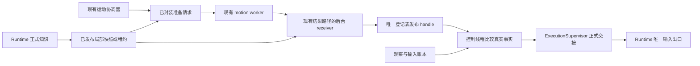

# 提前准备与可信注册运动证明架构 v1

日期：2026-10-12。状态：**设计冻结；尚未实施正式链。**

> 2026-10-13：D103 已在 G2-F2 Task C 止损。[D104](../decisions/0104-slim-motion-proofs-before-continuity.md) 改为先缩小证明，再简化 receiver 与快照。本文中“每个边界保存完整尾迹”“receiver 重构造整份对象图”和旧 G2 零物理调用门槛，不再作为后续实施要求；历史试验事实保持不变。

决定见 [D102](../decisions/0102-prepare-and-register-motion-proof-ahead-of-handoff.md)，试验依据见[D102／D103 验收](../acceptance/prepared-motion-proof-spikes-d102-d103.md)。本规格沿用 [D099](../decisions/0099-adopt-game-first-risk-graded-short-open-loop-control.md)、[D100](../decisions/0100-use-risk-aware-continuous-deviation-recovery.md)、[D101](../decisions/0101-clarify-short-open-loop-timing-and-lifecycle.md)和[按风险连续运动架构](risk-aware-continuous-motion-v1.md)。下文是正式契约要求，不表示对应能力已经实现。

## 1. 目标和边界

下一动作应在当前动作运行时完成准备。等真实身体到达交接处，控制线程只核对已经登记的依据。它不临时复制世界、不重新搜索、不扫描完整轨迹，也不解包大对象。

“运动证明”指可信计算器产生的完整主轨迹、各边界安全尾迹、依赖事实与执行条件。“注册”指父侧完成独立校验后，把不可变证明保存到唯一结果登记表。“handle”是该表发布的只读引用；它只能证明准备工作已完成，不能自行授权输入或接管身体。

本规格只规定提前准备、可信注册与交接的公共边界。它不新增动作、优化寻路算法、不复制物理公式、不建立通用缓存或插件框架，也不改变正式伤害额度、UNKNOWN 规则和客户端许可窗口。

## 2. Owner 与长期状态

每类长期状态只有一个 owner。表中的 receiver 和登记表是现有 motion 结果路径的职责，不是额外的协调系统。

| Owner／模块 | 唯一拥有的状态或职责 | 对外提供什么 |
|---|---|---|
| Runtime／正式世界知识 | 当前世界会话、正式观察、事实版本、局部不可变快照及租约 | 已发布的快照引用、版本与依赖变化事实 |
| 现有运动协调器 `MotionRouteCoordinator` | 下一动作的准备需求、入口、路线／动作身份；创建和换代严格动作的输入流 generation；沿用现有计算身份和退场 | 完整准备请求、expected inputs、输入流身份、交接申请、证明使用／释放事实 |
| 现有 `MotionSolverWorker`／`MotionWorkerPort` | 有界计算作业与既有进程资源 | 不可变候选结果或 typed 计算失败；不拥有身体或世界 |
| 现有 `MotionResultInbox` 的后台 receiver／登记职责 | 同一结果服务内的计算接纳记录与证明引用记录；登记表唯一记录 candidate／executing／safe-tail 用途 | 已注册 handle、typed 接纳结果、引用保留／释放确认、诊断指标 |
| 当前动作 owner／`ActionRouteExecutor` | 已接纳动作的执行进度与已授权安全收尾；消费协调器的输入流身份，不另行换代 | 当前身体责任、关键节点事实、正式交接证据、证明使用／释放事实 |
| `ExecutionSupervisor` | 唯一身体 owner 的选择、保持与交接 | 明确的交接或保留决定 |
| Runtime／唯一输入出口与正式账本 | 仲裁后的全局序号分配、输入流激活绑定、发送、实际采样／应用、首条回执、逐条撤销终态和许可 | 有类型的激活与真实输入事实 |
| `FixedRouteController` | 唯一普通宽地面控制与既有租约／回退 | 原路线、局部接回或危险规避的地面输入 |
| `NavigationSession` | 任务目标与正式重规划 | 目标修订、取消和任务结果；不保存第二份准备状态 |

正式复用入口是 `motion_worker.py` 中的 `MotionSolverWorker`、`MotionWorkerPort`、`MotionResultInbox`，以及 `motion_coordination.py` 中的 `MotionRouteCoordinator`。现有 `AsyncWorkIdentity`、工作退场和请求预算继续约束新结果。具体类型适配留给另行授权的实施；不得把临时 D103 pipeline 复制进生产，再让两套 inbox 并行消费同一 worker。

receiver 可在既有 motion 服务的后台线程完成完整检查。它不能另建一套 pending、generation、重试账本或关闭入口。计算作业和证明引用由同一结果服务分别记录，使用同一份不可变 bundle；两者的结束条件不同。控制侧查询不等待 receiver 完整校验，也不持有会被大对象处理长期占用的锁。

### 2.1 计算、身体与输入流身份

| 身份 | 表示什么 | 唯一生产者／写入者 | 结束或变化的含义 |
|---|---|---|---|
| `AsyncWorkIdentity.owner_instance_id` | 哪个计算实例提交了工作 | 现有 `AsyncOwnerScope` 为协调器分配 | 只用于计算接纳与退场，不能代替身体 owner |
| `AsyncComputationScope.generation` | 当前任务允许接纳的计算批次 | 现有 `GoalRequestLedger` 通过 `invalidate_computation()` 推进 | 新旧计算资格变化，不自动撤销执行中安全尾迹 |
| `RouteControl.owner_id` | 当前路线中谁承担身体责任 | 现有 `RouteControl` 提供，由 `ExecutionSupervisor` 选择并交接 | 同一路线内切换动作通常保持同一身体 owner |
| D101 `StreamGeneration` | 一条严格输入流的输入、入口、许可和安全后缀绑定 | 现有 `MotionRouteCoordinator` 是正式动作链唯一创建／换代者 | 只有输入、入口、许可或安全后缀改变才换代；目标修订本身不换代 |
| `StreamActivationBinding` | 输入流首条命令赢得仲裁后，与实际全局序号及复合命令的绑定 | Runtime 唯一输入出口在最终仲裁／发送边界创建 | 准备时不预留实际序号；激活事实到达后才初始化执行 tracker |
| job token／证明登记 token | 一次在途计算／一份已接纳证明引用 | 同一结果服务分别登记 | job token 退场不注销已经转为动作引用的证明登记 token |

本规格单独写“generation”时指输入流 generation；计算换代明确写 `AsyncComputationScope.generation`。bundle 的 `owner` 指 `RouteControl.owner_id` 所代表的身体 owner，计算 owner 使用 `owner_instance_id` 单独绑定。三个身份不能共用一次“全部作废”。

`ActionRouteExecutor` 在正式动作链中消费和执行协调器提供的输入流身份，不另设输入流 generation 写入者。Runtime 和输入账本提供实际仲裁、激活、采样、应用与撤销事实，不创建输入流 generation；receiver 只校验和保存准备身份。计算 scope 失效可以拒绝未接纳工作，不能撤销已经承担责任且仍有效的安全尾迹。同一身体 owner 内的动作衔接可以改变 action／stream，不需要制造新的身体 owner。

## 3. 数据流

协调器根据当前观察、仍有效的前段和下一入口请求提前准备。取得快照、封装请求、序列化与摘要计算都在控制热路径之外完成。控制 tick 只提交已经封装的有界消息、查询已登记 handle、比较当前事实并生成现有动作提议。

worker 只使用传入快照和既有计算器。receiver 核验并发布后，真实入口到达时由现有动作链向监督者申请交接。任何后台状态都不能绕过 Runtime 仲裁和唯一输入出口。

## 4. 世界快照契约

### 4.1 世界只有一个拥有者

快照来自 Runtime／正式世界知识的已观察事实。它必须局部、有版本、不可变，并明确保留 UNKNOWN。快照租约表示：持有者持续引用一个不会被原地修改的事实版本。新观察生成新版本，不改变在途作业或已发布 handle 持有的旧对象。已发布 handle 持续持有该不可变版本引用，不能在使用中让版本存储自行过期或被回收。

快照至少记录 world session、来源 world revision、局部 snapshot revision、snapshot digest、ruleset、覆盖区域、逐格事实与版本、观察来源和租约身份。摘要覆盖正式规范序列化字节；包含碰撞、支撑、材料与物理属性等实际计算条件。

worker 不访问活世界，不重新创建 fixture，不读取 TEST_ORACLE，不从快照之外补事实。范围不足、事实未知或材料不支持，分别返回缺信息或能力不足。

### 4.2 构造和序列化提前完成

优先持续维护局部不可变版本，或只导出观察变化带来的增量。控制线程只取得已发布引用和版本；不能每次准备动作都遍历全窗口、复制映射、解析全部形状或序列化整份世界。

租约取得必须有界且非阻塞。没有及时取得所需快照时，报告 `NOT_READY`，当前 owner 继续原有安全前段或已证明收尾；不能让控制线程同步补建快照。

快照导出过程必须保证内容、revision 和 digest 属于同一版事实。若导出过程中版本变化，只能交付一个仍可追溯的完整旧版本，或 typed 拒绝；不能混合两个版本再标成同一 revision。

### 4.3 来源身份与当前有效性分开

receiver 必须确认返回结果绑定的 world session、来源 revision、snapshot revision／digest 和预登记请求完全相同。把另一份世界或快照冒充原请求，直接拒绝。

当前世界的全局 revision 推进不自动作废全部准备结果。Runtime 用持续维护的事实版本和依赖索引判断是否相关；当前会话、规则和本证明依赖仍一致时，可以保留。支撑、净空、边缘、落地区或安全尾迹依赖发生变化，就作废受影响资格。

D103 的 revision 负例只覆盖精确版本错配拒绝，不能当成已验证“无关变化仍复用”的证据。正式契约要求后者另有隔离证据。控制线程只读维护好的变化标记或有界相关依赖，不扫描整个世界。

快照租约释放与世界依赖变化是两个事实。释放租约只减少对旧不可变版本的引用，不撤销仍有引用的证明资格；相关事实变化则由 Runtime 发布有界依赖变化事实，登记资格在下次热比较失效。执行中 owner 仍承担身体责任；能否继续安全尾迹，要独立核对该尾迹的实际依赖，不能因保留旧版本就继续使用已经失效的事实。

## 5. 不可变请求、bundle 与 handle

### 5.1 父侧预登记请求

提交前，现有结果路径保存不可变的父侧记录：完整 request、`AsyncWorkIdentity`／计算 scope、不可复用的 job token、输入流 generation、身体 owner、路线／动作身份、expected inputs 的精确元组及预先计算的 digest、ledger／session identity、requested start tick 与 effect window、许可与时序分支、入口和安全收尾要求、快照身份、继承依赖、伤害额度和计算预算。此时不产生、不猜测也不预留未来命令的实际 control sequence。

| 预登记字段 | 生产者 | receiver 的职责 |
|---|---|---|
| request、expected inputs／digest、入口／出口、安全后缀、route／action、输入流 generation、requested start／effect window | 现有 `MotionRouteCoordinator`，按动作执行契约确定 | 与返回结果独立比较，不从结果倒推或生成 |
| world、snapshot／digest、事实版本和 snapshot lease | Runtime／正式世界知识 | 检查来源与当前依赖，保存不可变版本引用 |
| ledger／session identity、已经存在的采样／应用及不可撤回事实 | Runtime 唯一输入出口的现有输入账本 owner | 核对既有父侧输入事实，不生成未来序号 |
| 身体 owner | 当前 `RouteControl`，由监督者确认 | 与请求、proof 和正式交接事实核对 |
| 计算身份／scope、请求预算、伤害额度与余额 | 现有异步工作、任务账本及其 owner | 校验并保存，不复制 owner 状态 |

expected inputs 是父侧授权准备的输入，不从返回 bundle 倒推。这个证明准备请求要求输入已确定；worker 不得自行换成另一条合法输入再声称同一请求已完成。后续动作选择仍复用现有计算路径，但新的输入必须先形成新的、由父侧独立保留的请求，再准备对应 proof。

first control sequence 不属于这张预登记表。它由 Runtime 在首条命令真正赢得仲裁、取得最终复合命令的实际全局 sequence 后，写入第 5.5 节的激活事实。现有 `player_runtime_v1` 在仲裁发送边界使用全局 `request_sequence`；同帧还可以组合战斗／视角输入，因此运动层不能提前占用一个数值并假定它稍后仍是自己的首序号。

### 5.2 `PreparedMotionBundle`

bundle 及其内部对象图都不可变：冻结对象、元组和不可变值，或已封存字节。仅冻结最外层 dataclass 不够，内部映射、列表和引用也不得修改。

| 字段组 | 必须绑定的内容 |
|---|---|
| 请求与动作 | 完整 request／摘要、job token、异步工作身份／计算 scope、输入流 generation、身体 owner、目标与路线修订、route id、action id／index |
| 输入与账本 | expected inputs 精确序列及 digest、返回 inputs、ledger／session identity、按 generation＋命令索引表示的未来输入、已存在的采样／不可撤回事实；不含尚未产生的实际首序号 |
| 身体范围 | 入口的位置、速度、朝向、姿态与支撑范围；关键节点范围；承诺点与最后可放弃点 |
| 出口 | 正常出口、允许落地区、可交接状态、下一入口或恢复入口要求 |
| 世界 | world session／来源 revision、局部 snapshot revision／digest／租约、覆盖范围、实际 dependency facts 与逐格版本 |
| 规则和风险 | ruleset 身份与完整规则、任务伤害额度及计算时使用的余额、能力和动作前提 |
| 证明 | 完整 proof、规范 proof digest、主轨迹、时序分支、逐边界停止／落地依据和风险判定 |
| 安全收尾 | 欠载时可用的有限安全前段、停车／落地尾迹、对应入口／分支／依赖和结束条件 |
| 执行资格 | 首条许可窗口、后续绝对 movement tick、0／1 起点分支与等待前缀、请求有效期限 |
| 封存 | schema／ruleset 版本、消息与 bundle 封存 bytes／digest，覆盖上述绑定 |

入口若是范围，完整证明就必须覆盖该范围。精确状态证明只能声明单点资格。不得放宽 `MotionResidualThresholds` 或把真实状态夹回范围，来让旧 bundle 通过。

伤害预算仍由现有任务 owner 维护。bundle 记录证明使用的额度；执行时与当前剩余额度比较，多份准备结果不能分别消费同一份未登记的余额。

### 5.3 已注册 handle

handle 引用登记表中同一个不可变 bundle，并带证明登记 token、请求／输入流 generation／身体 owner 身份、已检查摘要、依赖版本和有界热路径比较视图。证明登记 token 与计算 job token 分开。热路径视图在登记时生成，不另存一份权威路线、世界或身体状态。

handle 只能由唯一 receiver 的成功登记路径发布。外部传入、字段相同的新副本、已注销的证明登记 token、已取消候选或已经作废的 handle 都不能授权新动作。旧输入流 generation 的迟回结果不能重新接纳；计算 token 完成退场不影响已经安装的执行引用，也不撤销仍有效的安全尾迹。控制侧核对对应用途的登记身份与不可变引用，不重新计算完整 bytes 或 proof 的 SHA-256。

### 5.4 计算完成后怎样保留证明

计算成功接纳时，结果服务先把同一份不可变 bundle 登记为动作候选引用，再确认计算完成。协调器随后可以结束 `AsyncWorkLifecycle` 并 `retire()` 原 `AsyncWorkIdentity`／inbox job token。这一步删除待接纳计算记录，不注销证明登记 token。当前代码在安装候选后调用 `_retire_work("motion_proof_installed")`；正式适配必须保留这一计算结束语义，并在退场前完成证明引用转移。

既有协调器／执行器发出证明使用和释放事实，registry 是唯一引用记录者。它在同一结果服务内记录下面三种用途，不另建 pending 或协调状态机：

| 引用用途 | 保留条件 | 释放条件 |
|---|---|---|
| `candidate` | 动作尚未执行，候选仍可用于未来交接 | 未使用候选取消、过期或作废；或者用途已转移为 `executing` |
| `executing` | 已正式接纳的动作仍在执行，身体与真实命令事实还需要该证明 | 安全交接完成、相关应用／撤销终态齐全、监督者确认该动作不再承担身体责任，并释放最后执行使用引用 |
| `safe-tail` | 已采样／应用输入造成的运动仍需安全前段、停车或落地尾迹 | 收尾责任已解决、真实命令终态齐全，监督者确认释放最后相关身体责任，并释放最后尾迹使用引用 |

三种用途引用同一个 bundle，独立记录使用者，不能把一个用途的结束当成整份证明注销。candidate 可以提交首条输入提议；实际开始执行必须取得匹配的 Runtime 激活事实，并由 registry 确认 candidate 转 executing，才可从唯一输入出口发送该动作首条命令。准备下一动作只创建下一计算／候选记录，不能撤掉当前 executing 或 safe-tail 引用。同一路线内交接后，身体 owner 可以继续存在；监督者确认的是旧动作／尾迹的责任已经结束，不要求销毁整个 `RouteControl`。

引用释放先处理资格和责任，再回收存储。未使用候选先撤掉未来动作资格，释放其候选引用；在途接纳和发布结束后才能释放计算引用。正在执行的用途必须先满足上表责任与命令终态条件。registry 确认最后一个候选、执行、尾迹或在途校验引用释放后，才能归还该证明持有的 snapshot lease、释放 bundle 及仍被它引用的大对象 bytes。

不再被引用的已校验传输封装 bytes 可以先回收，但 handle 所依赖的封存 bytes、proof 与最小安全事实必须保留。释放内存不是撤销执行资格的操作；计算退场或节省大对象空间也不能代替身体释放证据。服务关闭时的保留规则见第 11 节。

### 5.5 首条命令赢得仲裁后绑定实际序号

正式执行使用两阶段事实。准备阶段只登记 bundle 的 generation、ledger／session、expected inputs 和 requested start／effect window。未来命令用输入流 generation＋命令索引表示；已发生的不可撤回输入事实仍保留其真实序号。Runtime 激活不会修改不可变 bundle、重写 proof 或重算完整摘要。

`StreamActivationBinding` 是 Runtime 唯一输入出口在最终仲裁／发送边界创建的不可变事实，至少绑定：证明登记 token、输入流 generation、身体 owner、ledger／session identity、实际 first control sequence、requested start／effect window、该首条命令的提交 tick，以及实际复合命令身份。实际 effect tick 由后续应用回执确认，不在发送前冒充已知。

只有首条运动提议真正赢得仲裁、最终复合命令的运动／视角投影仍匹配已证明输入、generation 与许可仍有效时，Runtime 才生成对应激活事实。命令可以包含同帧战斗或视角内容，但不能用复合命令身份掩盖会改变已证明运动的内容。执行器／tracker 必须在第一条实际应用回执前收到并核对该事实；登记 handle、激活事实与正式身体交接条件全部成立，才能开始该流。

首条未赢仲裁则不生成该流激活事实，bundle 保持 candidate，直到以后满足窗口或过期。绑定错配或 generation 已失效，返回 typed `ACTIVATION_MISMATCH`／`STALE_GENERATION`，不能发送或推进该 bundle 的身体输入。此类拒绝的 bundle 推进计数为 0；不能为让证明通过而预占全局序号、修改账本事实或抢占其他 owner 的仲裁结果。

第一条实际应用回执仍必须立即上报，以激活事实的实际首序号核对归属，并按 requested tick 与真实 effect tick 选择唯一 0／1 tick 起点分支。后续命令从同一实际首序号关联流内索引与 Runtime 的实际序号，effect tick 按同一已确认偏移推导；不提前预留后续全局序号，也不为中段输入重新选择起点。若后续仲裁、应用内容或时序破坏这个关联，按 D101 偏离处理。

这没有放宽 D101 的首条身份与时序门槛。它把准备身份和实际序号事实分开：现有隔离 `StreamGeneration.first_control_sequence` 的数值在正式适配中由 Runtime 激活提供，不是协调器或 receiver 的预留 API。

## 6. 后台完整接纳

接纳顺序固定如下：

1. 确认 job token 仍属于有效请求，消息大小、schema 与摘要符合已登记边界；校验消息 bytes 摘要后再反序列化。
2. 核对 `proof.ruleset == bundle.ruleset == snapshot.ruleset`，并确认它们与当前正式运行 ruleset 相同。重新封存也不能跳过三向关系。
3. 检查整个内部对象图不可变；检查 proof 结构完整、分支与安全尾迹存在，规范序列化完整 proof 并重算 digest。
4. 比较返回 inputs 与父侧 expected inputs 的精确序列，及返回 input digest 与提交前 expected digest；同时检查 proof／bundle 的内部一致性。
5. 分别比较完整 request／计算身份、预登记输入流 generation、身体 owner、路线／动作、入口／出口、requested start／effect window、许可／时序、伤害额度、ledger／session identity 与已存在的边界输入事实。receiver 不生成、猜测或要求预登记尚未分配的首条 sequence。
6. 检查来源 world session／revision、snapshot digest 和 dependency facts；proof 的实际依赖必须来自该快照，继承依赖也必须满足父侧请求。再比较当前相关依赖和租约有效性。
7. 在同一个登记／计算退场同步边界再次确认 job token／计算 scope 仍可接纳，输入流 generation 仍适用于该候选，随后原子登记 candidate 引用并发布 handle。计算取消若先发生，发布必须失败；发布后候选取消，撤掉未使用候选资格。已转为 executing／safe-tail 的引用按第 5.4 节结束，不能由计算取消直接注销。

所有步骤都在现有结果路径的后台 receiver 完成。完整接纳失败不发布 handle。不能只比较 bundle 与 proof 内部字段，不能只相信 worker 自报的 proof hash，也不能因为正常 worker 一直返回合法结果就省略父侧独立比较。

可信来源是项目现有计算器与受控 worker。SHA-256 用来发现内容错误，不能认证外部不可信证明。pickle 若继续用于内部传递，只允许受控进程与受限来源；本设计不接纳任意网络 pickle，也不把对抗进程内任意内存修改当作现行能力。

## 7. 控制线程比较与正式交接

每 tick 只允许有界读取和比较：证明登记 token 与对应使用用途、request／输入流 generation／身体 owner／route／action、Runtime 激活事实及其实际序号／复合命令身份、持续持有的不可变快照版本、真实身体范围、支撑与姿态、已确定时序分支、当前许可、账本事实、相关依赖变化标记、当前伤害余额和安全收尾资格。计算 job token 或 scope 的退场不作为执行中证明失效条件。

scan、搜索、整段物理回放、完整 proof 哈希、序列化／反序列化、快照复制和长时间锁等待禁止进入控制热路径。只将这些工作从主线程搬到 receiver 仍不足以声明通过；必须测量实际控制负载和 Python 线程争用造成的唤醒延迟。

关键节点一致时只比较。监视和已登记证明的存活状态范围比较，不能仅与“上一观察加实际输入”的即时一步预测自比。当前身体不在范围内时，旧准备资格失效；从真实状态按 D100 接回或重准备，不能让身体退回预测点来迁就旧结果。

正式交接必须同时满足：

- 新 handle 仍登记、未作废，身份、依赖、规则与时序有效；
- 首条命令执行前取得匹配的 Runtime 激活事实，实际首序号与复合命令身份可以交给 tracker 核对；
- 真实身体进入新动作已证明入口，许可仍能满足；
- 当前 owner 已到可交接边界，并给出正式交接／释放证据；
- 冲突未来命令已有明确撤销终态；
- `ExecutionSupervisor` 明确选择继任者，Runtime 仲裁采用新输入。

准备 bundle 不拥有身体。当前 owner 持续负责直到监督者批准；新结果晚到或错配不能清空现有安全前段。D103 的同 owner 两跳只是这个责任边界的隔离例子，不代表监督者正式接口已经接入。

## 8. 有类型的结果

状态和原因使用枚举或不可变结果，不能用任意 `reason` 字符串暗中改变权限。下列名称表达契约语义，不要求在 Session 增加对应状态机。

| 环节 | typed 结果 | 含义 |
|---|---|---|
| 提交 | `ACCEPTED`／`QUEUE_FULL`／`CLOSED` | 已登记并进入有界作业，或明确未接收 |
| 计算 | `PREPARED`／`MISSING_INFORMATION`／`UNSUPPORTED`／`BLOCKED`／`BUDGET_EXHAUSTED`／`WORKER_FAILED` | 完整候选、缺信息、不支持、阻塞、计算预算耗尽或工作故障 |
| 接纳 | `REGISTERED`／`STALE`／`CANCELLED`／`REJECTED` | 已可信登记，已失效，已取消或契约不符 |
| 首条激活 | `ACTIVATED`／`NOT_SELECTED`／`ACTIVATION_MISMATCH`／`STALE_GENERATION` | Runtime 创建了匹配激活事实、未赢仲裁、绑定不符或输入流已失效 |
| 查询／比较 | `READY_MATCH`／`NOT_READY`／`OVERDUE`／`ENTRY_MISMATCH`／`DEPENDENCY_CHANGED`／`TIMING_MISMATCH` | 可申请交接、尚未可用、超过交接期限或当前事实不符 |
| 身体处理 | 现有继续／安全收尾／正式交接／`BODY_RESPONSIBILITY_UNRESOLVED` | 由当前 owner 与监督者处理，不由准备结果决定 |

`REJECTED` 的原因至少区分消息完整性、proof 完整性、不可变图、request、generation／owner、route／action、expected inputs、账本、三向 ruleset、world／snapshot 和依赖。typed 原因保留于诊断，不能把拒绝降级为可执行候选。

计算预算耗尽与交付超期分开。前者来自既有节点／物理步等预算；后者表示在指定 movement tick 前没有可消费 handle。行为选择不读取墙钟；墙钟只用于测量、调度节拍和资源有界关闭。

## 9. 作废、取消与替换

目标修订先判断现有输入流和准备候选是否仍适用。`MotionRouteCoordinator` 只有在输入、入口、许可或安全后缀改变时才更换输入流 generation。`GoalRequestLedger` 的计算 scope 换代只使未接纳工作失效，不连带注销已执行证明或仍有效的安全前段。

作废范围由实际依赖决定。失效的未来动作请求退场，未使用 candidate 撤掉资格并释放引用。Runtime 发布相关依赖变化时，executing 的受影响资格在下次热比较失效，但引用和身体责任仍保留到正式解决。相关变化也影响当前安全尾迹时，按 D100 的危险规避或承诺后恢复处理，不能继续使用失效尾迹，也不能靠释放快照来宣称责任结束。

取消准备作业先在既有请求记录写入不可逆退场状态。尚未提交的消息停止发送，在途计算可以受既有预算结束，但迟回结果不得登记。job token 不复用；仅清空本地队列或删除 pending 不能代替退场事实。receiver 完整检查期间取消，也必须在发布边界胜过旧结果，防止旧工作重新出现。

取消未来输入沿用 D101：客户端必须给已接收命令明确终态，包括已应用、已撤销、来不及撤销或未执行。已经采样的事实不能删除。新 generation 只有在正式交接与冲突命令终态满足时替换旧流；同一 owner 的同一未来 tick 最多由一个 generation 授权。

退场诊断沿用现有有界历史，不能代替执行引用登记。仍承担身体责任、等待真实命令终态或被在途接纳引用的身份不能因历史容量不足被提前删除。执行引用注销遵守第 5.4 节，准备下一动作或退场旧计算不改变这个条件。

## 10. 迟交付与欠载收尾

准备期限到达而 handle 不可用时，typed 返回 `OVERDUE`。只允许使用事先证明并登记、仍覆盖当前真实状态／分支／依赖的安全前段、停车尾迹或落地尾迹。迟结果即使之后完成，也不能补回错过的许可；需要新的请求与当前真实入口。

承诺前拿不到证据，不提交不可撤销动作。承诺后原 owner 负责安全落地。安全收尾结束且满足释放条件，才正式交接；仍在承诺阶段则保留责任并报告 `BODY_RESPONSIBILITY_UNRESOLVED`。这个结果表示问题没有解决，不能算作安全通过。

D103 六项 800 ms 延迟样本使用预登记的 `Walk×1→Neutral×16`，最终停在中间平台。该序列只是隔离场景证据，不能硬编码为所有动作的通用欠载办法。普通宽地面继续由 `FixedRouteController` 现有租约和回退处理。

## 11. 队列、线程和进程生命周期

复用现有 motion worker 的持久进程与有界请求／结果通道。请求数、未消费结果、登记对象、封存 bytes、快照租约和退场历史均有明确上限。容量具体数值由另行授权的正式隔离验收冻结；D103 的容量 2 只支持一个前序作业加第二跳，不能成为多任务调度保证。

控制侧提交和查询必须非阻塞。满队列返回 `QUEUE_FULL`，不覆盖旧作业，不无限重试，不丢弃承担安全责任的身份。排队、运行、接纳和发布都计入交付成本；登记数量有界还不够，大对象总字节量也要有界。优先级若以后需要改变，仍在同一作业服务内部解决，不另建高优先级 worker 管线。

关闭由现有服务生命周期统一负责，支持重复调用。正常结束、构造失败、父侧在途异常、worker 故障、满队列和阶段止损都停止接收新请求，退场未完成计算并释放未使用候选。在途校验／发布退出且对应最后引用释放后，才能归还这些工作持有的租约。receiver 与 worker 的等待、join、结果排空和队列清理均必须有界，不能等待一个永远不会到来的结果。

worker 硬退出要通过进程存活事实变成 typed `WORKER_FAILED`。服务关闭先尝试既有结束协议，超时后终止并再次有界 join；记录真实退出码。receiver 的等待须能被唤醒，并在退出前停止发布。队列 feeder 清理不能引入无期限 `join_thread()`。

计算服务关闭不代替身体收尾。关闭 worker／receiver 之前，既有动作 owner 与同一 registry 必须确认当前 executing／safe-tail 的最小不可变事实仍可读取，包括对应输入、分支、身体范围、相关依赖、许可、伤害依据与真实账本引用。计算进程和接收线程可以结束；registry 不再接纳新证明，但保留这些只读证明和所需 snapshot／bytes，并继续接收既有 owner 的有界释放事实。安全交接、命令终态齐全且监督者释放最后身体责任后，现有服务才释放最后引用并销毁相应登记记录。

关闭时不能在控制热路径临时裁剪或重建证明。只可保留已经登记的最小收尾视图；没有这样的视图就继续持有完整 bundle 及其快照。最小视图仍由同一 registry 记录，不产生第二套执行证明。Runtime 停止期间也不能通过销毁 receiver 或释放内存来假装空中责任已经结束。

## 12. 可观测指标与性能门槛

Windows 是正式平台。完整控制决定要求 **P95≤8 ms、P99≤15 ms、最大值<30 ms**。决定涵盖读取已发布 handle、登记资格与当前事实比较、账本／回执、关键节点、伤害额度、正式交接与输入提议。生产观察接收、仲裁、发送等相关控制成本不得借阶段拆分漏掉。

后台耗时独立报告，不能当成免费工作，也不能把各分项 P99 相加当作总 P99。至少记录：

- 快照持续维护／增量导出、租约取得、构造、序列化、摘要与 bytes；
- 请求封装、提交、队列等待、worker 恢复快照、计算、结果封存与传输；
- receiver 摘要、反序列化、不可变图、三向 ruleset、完整 proof、expected inputs、当前依赖、登记和实际发布；Runtime 首条激活绑定与首回执关联；
- 从请求准备开始到 handle 实际发布，以及到首次控制消费的全程；
- 控制决定 P50／P95／P99／最大值、唤醒迟到、deadline miss、非阻塞查询成本；
- 排队／运行／接纳／登记数量与总 bytes、candidate／executing／safe-tail 引用、计算退场与最终引用释放、队列拒绝、取消期间发布拒绝、旧输入流 generation 拒绝；
- 交付提前量、落地到有效输入空档、完整停车、反向输入、速度保持、欠载收尾和安全失败；
- 实际执行线程、热路径禁止调用计数、关闭路径、残留 receiver／子进程与真实退出码。

热路径 scan／搜索／完整 proof hash／反序列化／整份快照构造调用必须为 0。连续动作已及时准备且真实入口匹配时，落地到后续有效输入空档沿用≤1 movement tick 的隔离目标；安全平台不产生非必要完整停车。更广入口范围、多方向和生产链必须有自己的正式证据。

后台没有从 D102／D103 推导出统一“提前 3 tick”硬期限。请求以许可与安全前段剩余 tick 声明实际交接期限，过期按安全收尾处理。D103 的 `ready_at` 早于 handle 字典发布，正式指标必须测到实际发布及消费，不能沿用这处测量空隙。

同机跨进程耗时只有在已确认共享单调时钟时才能相减。Fabric 的客户端／Python 时间线通过 episode、请求／观察序号和 movement tick 对齐；不能直接相减不同进程或机器的未知时钟。

## 13. 安全不变量与待正式验证边界

1. Runtime 是世界和唯一真实输入出口的权威；监督者是身体交接的权威。
2. 准备请求、bundle、内部对象和发布 handle 不可变，来源与父侧期待独立绑定。
3. UNKNOWN、缺信息、不支持、预算耗尽、超期和契约拒绝不能变成执行许可。
4. 当前 owner 不因目标修订、取消、结果失效或服务关闭自动释放身体。
5. 未登记、已注销引用、已取消候选、错配或失效 handle 不得授权新动作；计算退场不能撤销已承担责任且仍有效的安全尾迹，同一未来 tick 不得存在冲突输入流 generation。
6. 0／1 tick 只在流起点；第一回执立即剪枝，中段缺失或晚到不能重新选择分支。
7. 一致关键节点只比较；证明范围不能由归因阈值、夹取状态或事后扩大得到。
8. 迟交付和欠载只使用预登记且仍有效的安全尾迹；安全落地与任务成功分开。
9. 工作量、队列、字节、期限、退场历史与资源退出有界，控制线程不等待重工作。
10. 世界和取消事实在发布后发生变化时，下一次热比较必须阻止失效资格；完整校验不能取代实时比较。
11. 实际 control sequence 只由 Runtime 唯一输入出口分配；准备工作不预留序号，未匹配 handle 与激活事实的流不得开始执行。

D102／D103 未验证的正式边界包括：入口范围及 ±0.05 落点偏差、多方向、多并发、复杂材料、动态依赖、receiver 校验期间取消、正式控制链完整耗时、全局序号分配、客户端撤销／替换和真实 Fabric tick 顺序。它们是后续验收边界，当前不写通过。

后续只按“契约→正式隔离矩阵→正式 Python 链单一组合→Fabric tick 顺序→扩展动作”的原则推进，不在本规格列任务、代码改动清单或实施计划。Fabric M2 或同等 tick 顺序试验完成前，不决定有限预排程。

## 14. 当前事实

本次只增加设计文档与紧凑证据，没有修改生产／测试代码，没有接入正式链或运行 Fabric。D101 M0 整体失败、M1／M2 未实施和 D098 P3 失败都保持不变。D102／D103 的 APPROVED 仅签署各自隔离试验的声明范围。

## 15. D121 显式尾段执行的本地接口

D121 及时输入组件入口把带紧凑绑定的 committed proof 绑定给唯一当前 `VerifiedMotionExecutor`。该执行器缓存已验证分支和输入视图，逐真实 receipt 消费主后缀、精确 fallback 和松键见证。普通接纳器继续拒绝这种许可；紧凑绑定不能启动后继。

Runtime 通过可选本地 `IncumbentFallbackPort` 向同一 supervisor 借用本次尚未发送的备用 action。值绑定当前执行器、owner、真实 sequence 和 exact window，不能序列化为 worker 消息。activation 任一 commit 前拒绝由该端口登记实际 fallback；随后仍由 Runtime 唯一出口发送。成功 commit 后不回滚。当前执行器实际完成见证后，supervisor 才确认释放；普通和新路径的 prepared executing／safe-tail 引用都使用原 ledger、动作退出和 supervisor 证据，经原 release_usage 注销。

L 与 tail 不新增物理计算或证明重建。每个真实观察允许既有 residual 监视的一步预测；摘要、规范编码、pickle、variant重建和证明／tail重放均不进入该路径。此接口只签署及时输入组件范围；真实 transport L+2、规划器接入和 Fabric 仍需各自验收。
